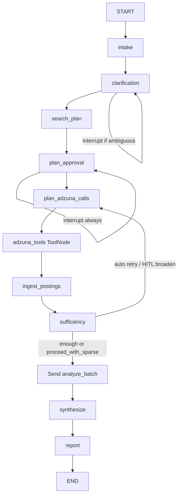

# Market Scout Agent — Architecture

## Applications

```text
C:\Market_Scout_Agent
├── frontend/     React + Vite + TypeScript UI
├── backend/      FastAPI HTTP, Google OAuth, run metadata
└── ai-service/   LangGraph StateGraph, Adzuna tool, analysis, reports
```

The backend never re-implements graph logic. It calls `ResearchGraphRunner` from `ai-service`.

```text
UI  --HTTPS cookie session-->  FastAPI  --Python import-->  ResearchGraphRunner
                                                      |
                                                      +-- SqliteSaver checkpoints
                                                      +-- Adzuna @tool / ToolNode
                                                      +-- optional LiteLLM chat
```

## Graph



### Typed state (selected fields)

`GraphState` in `ai-service/graph/state.py` holds the hiring request, search plan, raw postings, reducer-merged `batch_analyses`, deterministic `stats`, validated `report`, HITL answers, and append-only `logs`.

### HITL

LangGraph `interrupt()` pauses the thread. FastAPI `POST /api/research/{id}/resume` calls `Command(resume=payload)` on the same `thread_id`. Checkpoints live in SQLite (`backend/data/checkpoints.db`).

| Checkpoint | Node | Resume payload |
|---|---|---|
| Clarification | `clarification` | `{answers: {q1, q2}}` |
| Search plan | `plan_approval` | `{plan: SearchPlan}` |
| Low data | `sufficiency` | `{action: broaden_radius \| add_synonyms \| proceed_with_sparse}` |

### Statistics vs LLM

Python computes median, IQR, disclosure rate, currency/period normalization, skill counts, employer split, and posting-age. The LLM (when configured) only writes qualitative summary/recommendations. Predicted or missing salaries are never filled in. Report posting IDs are filtered to IDs actually retrieved.

## HTTP API

| Method | Path | Auth |
|---|---|---|
| POST | `/api/auth/google` | public |
| GET | `/api/auth/me` | session |
| POST | `/api/auth/logout` | session |
| POST | `/api/research` | session |
| GET | `/api/research` | session |
| GET | `/api/research/{id}` | session |
| POST | `/api/research/{id}/resume` | session |
| GET | `/api/research/{id}/events` | session |
| GET | `/api/research/{id}/report` | session |

Aliases: `POST /api/research/start`, `GET /api/research/runs`, `GET /api/briefs/{id}`.

## Auth

Google ID tokens are verified with `google.oauth2.id_token`. Access tokens are verified via Google `tokeninfo` (audience = `GOOGLE_CLIENT_ID`) then userinfo. The API issues an HTTP-only session JWT. The frontend never receives a Google client secret.
