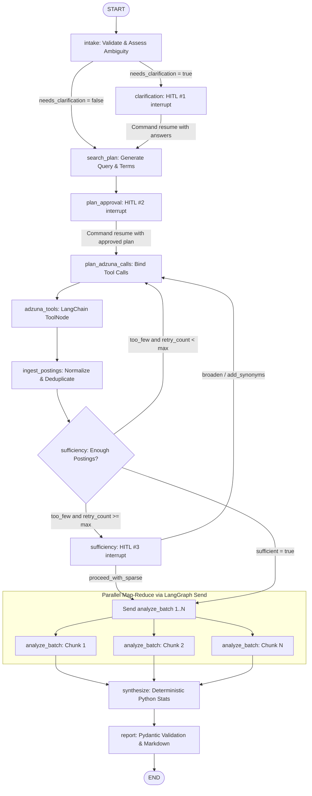

# Joveo Talent Market Scout Agent — Assessment Write-up

**Candidate / Project:** Talent Market Scout Agent  
**Frameworks:** LangGraph, LangChain, FastAPI, React 18, SQLite, Pydantic  
**Document Scope:** Technical Architecture, HITL Design, Prompting & Schemas, Context Window Management, Honest Failure Modes, and Future Improvements.

---

## 1. Graph Architecture & State Schema

### 1.1 Architectural Rationale
The agent is designed as an explicit, stateful, multi-step graph in LangGraph rather than a monolithic black-box chain or a loose ReAct agent. A recruitment market scout requires predictable phases: intake classification, clarification guardrails, pre-fetch search plan approval, bounded API tool execution, sufficiency evaluation, map-reduce batching, and deterministic statistical synthesis.

Each phase is isolated in a single-responsibility node. All state mutations are governed by typed schemas with functional reducers, preventing silent overwrites and race conditions.

### 1.2 State Schema (`GraphState`)
Located in `ai-service/graph/state.py`, `GraphState` is a typed dictionary tracking the entire lifecycle:
- **`request`** (`dict`): Raw hiring request (role, location, seniority, currency, client purpose, focus).
- **`needs_clarification`** (`bool`) & **`clarification_questions`** (`list[dict]`): Questions generated if ambiguous.
- **`clarification_answers`** (`dict[str, str]`): Operator's supplied answers.
- **`search_plan`** (`dict`): Drafted title synonyms, skill keywords, location scope, and radius.
- **`plan_approved`** (`bool`): Gatekeeper flag before API credits are consumed.
- **`postings`** (`list[dict]`): Deduplicated raw postings with metadata preserved.
- **`batch_analyses`** (`Annotated[list[dict], operator.add]`): Reducer-backed list accumulating parallel batch outputs.
- **`stats`** (`dict`): Deterministic mathematical calculations (median, IQR, disclosure rate, skill frequency).
- **`report`** (`dict`): Validated final structured market brief.
- **`logs`** (`Annotated[list[dict], operator.add]`): Immutable audit log of every node transition and event.

---

## 2. Human-in-the-Loop (HITL) Design

### 2.1 Where the Agent Pauses and Why
The system enforces three distinct human guardrails where autonomous LLM decisions pose real-world risks:

| Checkpoint | Graph Node | Rationale |
|---|---|---|
| **1. Clarification** | `clarification` | Triggered only when role/location is ambiguous (e.g. "Engineer, Texas"). Prevents querying wrong labor markets or burning API quotas on vague inputs. Skipped for unambiguous roles (e.g. "Data Analyst, Bangalore"). |
| **2. Search Plan Approval** | `plan_approval` | Always triggered before external API calls. Gives recruiters oversight of search queries, radius, and keywords before spending API credits. |
| **3. Low-Data Sufficiency** | `sufficiency` | Triggered when API returns fewer than `min_postings` after automated retries. Asks the operator whether to broaden radius, expand synonyms, or accept a sparse directional sample. |

### 2.2 Persistence & Resumption Mechanics
- **Checkpointer:** `SqliteSaver` persists state snapshots to SQLite (`backend/data/checkpoints.db`) indexed by `thread_id`.
- **Interrupt:** LangGraph's native `interrupt(payload)` halts graph execution, saves thread state, and returns the checkpoint details to the caller.
- **Resumption:** The operator resumes execution via `Command(resume=payload)`. For clarification, `payload` contains `{answers: {q1: ...}}`; for search plans, `{plan: edited_plan}`; for low data, `{action: "broaden_radius" | "proceed_with_sparse"}`.
- **Process Resilience:** Because checkpoints reside in SQLite rather than volatile RAM, server restarts or network drops do not lose run state; the operator can resume hours later on the exact same thread.

---

## 3. Prompting Strategy & Structured Output

### 3.1 Separation of Concerns: Python Math vs. LLM Synthesis
A core architectural decision is **never letting the LLM calculate or invent numbers**:
- **Deterministic Python:** Computes sample count, median salary, 25th and 75th percentiles (IQR), disclosure rate, skill frequencies, and direct employer vs. staffing agency percentages.
- **LLM Role:** Focuses strictly on qualitative reasoning: writing the executive summary, formulating client recommendations (salary band hook, lead skills), assigning the hiring outlook, and drafting actionable insights.
- **Evidence Linking:** Every qualitative insight generated by the model is programmatically cross-referenced against the actual retrieved posting IDs (`samplePostingIds`) and verified sample count (`evidencePostingCount`).

### 3.2 Output Validation & Recovery
- Outputs are governed by Pydantic models (`MarketBrief`, `ConfidenceInsight`, `HiringOutlook`) with strict enum validation (`Favourable`, `Competitive`, `Hard to fill`).
- If an LLM response is malformed or times out, the system uses a fallback heuristic synthesizer (`synthesize.py`) that generates the report directly from the deterministic stats, ensuring the workflow never crashes or returns empty responses.

---

## 4. Context Window Management (>500 Postings)

### 4.1 Map-Reduce Batching via LangGraph `Send`
When researching competitive roles in major metros, job queries frequently return 500+ postings. Concatenating 500 full job descriptions into a single prompt consumes over 250,000 tokens, exceeding model context limits and causing rate limit errors.

**Implemented Solution:**
1. **Partitioning:** The `sufficiency` node evaluates posting count. If data is sufficient, the conditional edge splits postings into slices of `batch_size=40` (configurable).
2. **Dynamic Dispatch:** Slices are dispatched concurrently via LangGraph `Send("analyze_batch", {"batch_id": i, "postings": chunk})`.
3. **State Reducer:** Each batch worker extracts skills, salaries, and company types from its 40 postings. The results are accumulated into `batch_analyses` using `operator.add`.
4. **Final Aggregation:** The `synthesize` node receives the unified reduced list and runs deterministic population statistics across all batches.

---

## 5. Honest Failure Modes & System Limitations

1. **Adzuna Country Inference:** Adzuna requires a 2-letter ISO country code in its URL path (`/v1/api/jobs/in/search/`). The system infers country from the location text (e.g. "Bangalore" -> `in`, "London" -> `gb`, "Texas" -> `us`). Uncommon towns without country qualifiers can fall back to `us`, resulting in zero results until clarified.
2. **Missing & Predicted Salary Data:** In many markets, only 15%–35% of postings disclose salary. While the agent correctly ignores Adzuna's artificial `salary_is_predicted` flags and calculates disclosure rates honestly, small sample sizes (e.g., 3 disclosed salaries out of 25 postings) produce wide, volatile IQRs.
3. **Currency Normalization:** Cross-currency conversions use static exchange rates configured in `rates_to_usd`. Volatile currency shifts are not updated dynamically in real-time.
4. **LLM Context Latency:** While batching prevents context crashes, running 13 parallel batch requests on 520 postings creates API concurrency spikes that may trigger provider rate limits on tier-1 accounts without retry throttling.

---

## 6. What's Next: Future Roadmap

1. **Critic / Evaluator Reflection Node:** Add an automated verification node between `synthesize` and `report` that cross-checks the draft claims against raw posting text, flagging any statement not directly supported by cited job IDs.
2. **Supervisor Multi-Agent Decomposition:** Decompose the graph into specialist sub-agents (e.g., a *Compensation Specialist* querying Radford/Levels.fyi APIs, a *Skills Taxonomist* mapping to O*NET/ESCO frameworks, and a *Search Scout* optimizing Boolean queries).
3. **Long-Term Memory Store:** Integrate LangGraph `Store` (e.g. Postgres or Redis) to persist client-specific preferences (target margin requirements, preferred title tiers, excluded staffing competitors) across independent research runs.

